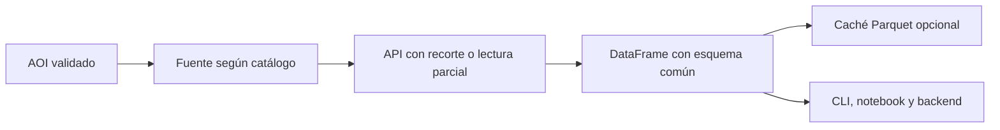

# Arquitectura

- `config/` contiene AOIs, fuentes y catálogo canónico.
- `nortex_data/sources/` contiene los adaptadores.
- `nortex_data/derive/` contiene cálculos reproducibles sobre series recortadas.
- `nortex_data/utils/` contiene validación, HTTP y el cliente AppEEARS.
- `tests/` contiene pruebas offline y consultas online acotadas.
- `scripts/build_docs.py` genera la tabla y sincroniza los archivos de configuración incluidos al instalar.
